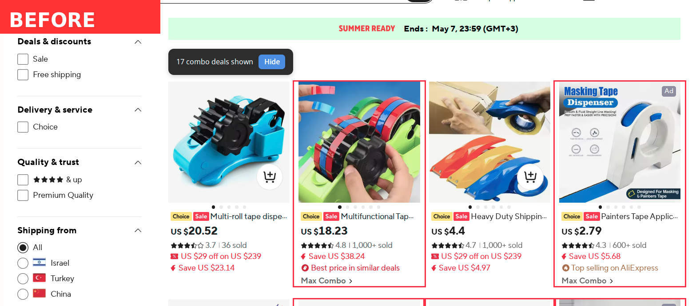
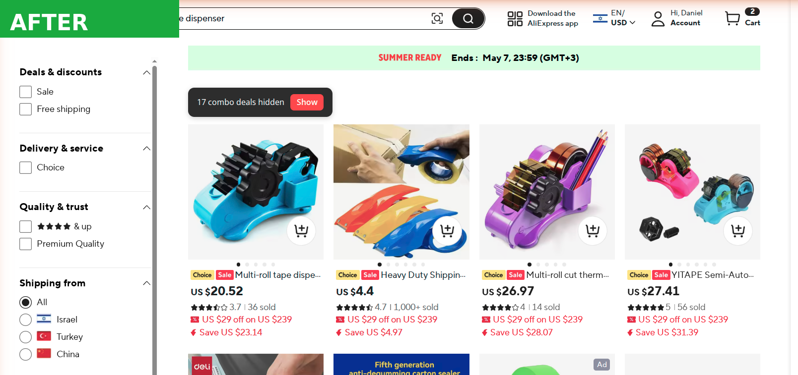
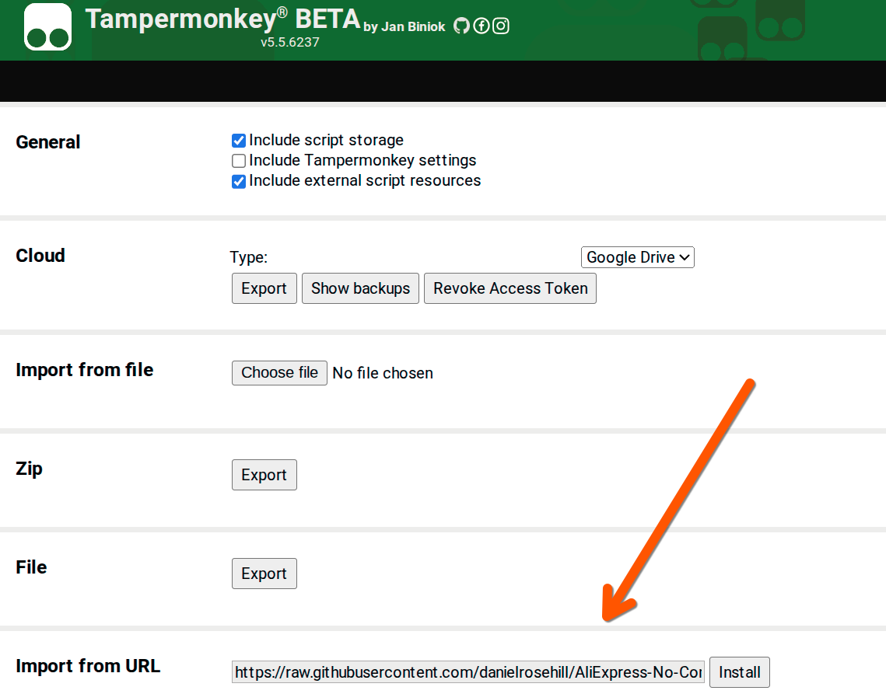
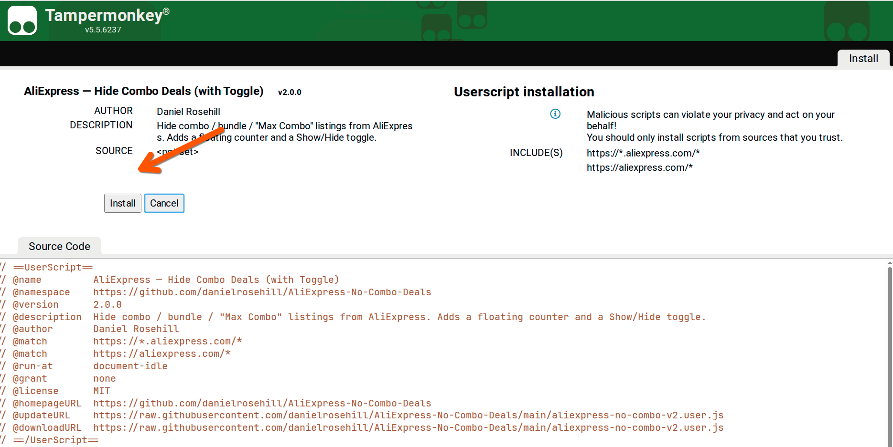
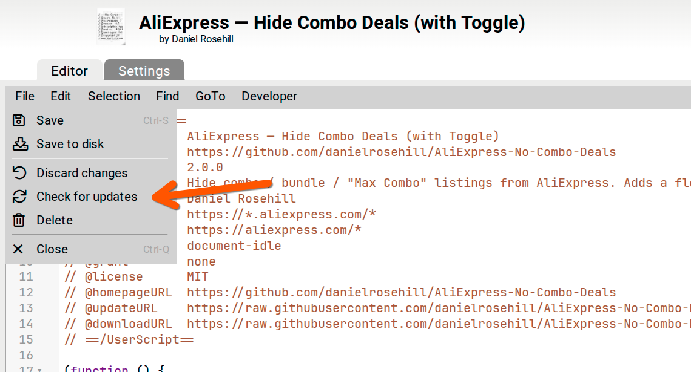
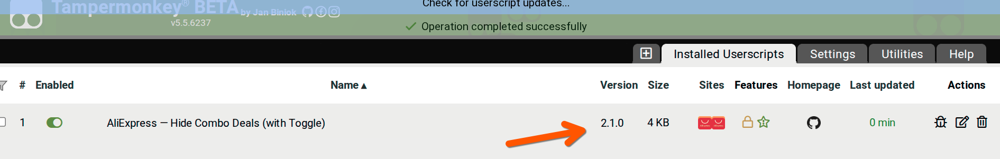

# AliExpress — Hide Combo Deals

A small userscript that hides combo / bundle / "Max Combo" listings from
AliExpress search and category pages, so the grid only shows single-item
listings.

## Before / after

**Before** — AliExpress search results with combo deals interspersed
(the cards outlined in red are bundles where the headline price is
conditional on buying multiple units):



**After** — same search with the userscript installed. Combo cards are
removed; an inline counter sits above the grid with a **Show** toggle
in case you want to see what was filtered out:



## Why

**Purpose: exclude AliExpress search results for items that are only
available via combo deals** — i.e. listings where the headline price is
conditional on buying a multi-item bundle ("Max Combo", "Combo deal",
"Bundle deal", etc.) rather than reflecting the price of a single unit.

These cards pollute search results because:

- The displayed price is the bundle price, not the single-unit price, so
  they break price-sorting and price-comparison.
- The actual single-unit price (if available at all) is usually higher
  than competing single-item listings.
- They're often pushed to the top of the grid by AliExpress's promo
  ranking, displacing genuine single-item options.

This script strips them out so the grid only shows listings you can
actually buy as a single item at the price shown.

## v2.6.0: filters panel and deep search

Top row (always visible): **On** switch, **Show bundle deals**, **Hide ads**, **Max
price** slider, **Choice All In**, **Deep search**, **Filters ▾**, and a
"Showing X of Y" count. The Filters panel holds collapsible sections:

- **Price**: min price (drops $1–3 bait listings).
- **Rating & sales**: min rating, hide unrated, min sold.
- **Title words**: per search, `word` / `"phrase"` required, `-word` / `-"phrase"`
  excluded; plus an "Always hide" list for every search.
- **Duplicates**: collapse listings whose titles share 80% of their words.
- **Sort this page**: price, most sold, top rated, best value
  (rating above 3★ × log(sales) ÷ √price).
- **Deep search**: pages to load (5/10/15/20) and auto-stop.
- **AliExpress filters**: 4★ & up, Ships from (these reload the search).

**Deep search** loads pages 1..N of the current search into one grid, so every
filter and the sort reach the long tail. It calls the endpoint the page itself
uses when you page (`POST /fn/search-pc/index`), one page every 1.5–3 s. Each card
is tagged with its page, and the panel shows matches per page, so you can see
where the signal runs out. The set is cached for the browser session (30 min), so
a refresh keeps it. Verified 2026-10-26 on `bluetooth gamepad`: 10 pages, 600 items
in 50 s, 10 requests, no captcha, 0 filter violations; pages 6–10 still yielded
5–15 matches each.

Out of the box only bundle deals are hidden; every other filter is off until you turn it on. Settings are kept in `localStorage` (`no-combo:settings-v2`) and hold across refreshes. 2.6.1 reset everyone to these defaults once, dropping price limits carried over from 2.5.
Filtered cards are hidden by a `data-nc-hide` attribute plus a stylesheet rule,
not inline style. **Brand+ pages** (`/ssr/300002748/…`) are a virtualised list, so
cards there are dimmed, not hidden; sort, deep search and AliExpress filters don't
apply there.

## What it hides

Cards that link to AliExpress's bundle landing page
(`/ssr/300000512/BundleDeals2?productIds=…`, v2.2.0+; works in any language), and
cards whose visible text contains any of:

- `Max Combo`
- `Combo deal`
- `Bundle deal`
- `Buy more save more`
- `More to love`

Matching is case-insensitive and tolerant of non-breaking spaces. Edit
`COMBO_MARKERS` in the script to add/remove phrases.

## Install

You need a userscript manager browser extension. Pick one:

| Browser | Recommended | Notes |
|---|---|---|
| Chrome / Edge / Brave / Opera | **Tampermonkey** | The default. Most actively maintained, supports auto-update. |
| Firefox | **Violentmonkey** (or Tampermonkey) | Both work; Violentmonkey is fully open source. |
| Safari | **Userscripts** (by Justin Wasack) | Free, App Store. |
| Greasemonkey (Firefox) | works but legacy | Tampermonkey/Violentmonkey are the modern choice. |

**Recommendation: Tampermonkey** — broadest compatibility, supports the
`@updateURL` / `@downloadURL` directives in this script so you'll get
updates automatically when this repo changes.

### One-click install

Two versions are published — pick one (or install both, they have
distinct names so they won't collide).

**v2 (recommended)** — adds a counter and Show/Hide toggle:

```
https://raw.githubusercontent.com/danielrosehill/AliExpress-No-Combo-Deals/main/aliexpress-no-combo-v2.user.js
```

**v1** — silent, hide-only, minimal:

```
https://raw.githubusercontent.com/danielrosehill/AliExpress-No-Combo-Deals/main/aliexpress-no-combo.user.js
```

### Step-by-step (Tampermonkey)

1. Open the Tampermonkey **Dashboard** → **Utilities** tab.
2. Paste the v2 URL above into the **Import from URL** field and click
   **Install**.

   

3. The script preview screen appears — click **Install**.

   

4. Reload any open AliExpress tab. Above the search grid you should see a dark bar
   with a dashed purple border and a **USERSCRIPT** tag (so it's clearly not
   AliExpress's own UI), holding (v2.5.0+):
   - `☐ Show bundle deals (N hidden)`: off by default, so bundles are hidden.
   - **Max-price slider**: Any price → $10, $20 … $70, $72. Hides cards whose price
     is over the setting. The top stop is $72, which leaves headroom under Israel's
     $75 customs de-minimis. Prices in ₪ are converted at `ILS_PER_USD` (3.7; edit it
     in the script). The card price is the cheapest variant's, so a hidden card is
     over the limit for every variant, but a shown one may still be over for the
     variant you want.
   - **Choice All In**: one click applies AliExpress's own *Choice* and *Free
     shipping* search filters together (it reloads the search with
     `selectedSwitches=filterCode:choice_atm,filterCode:freeshipping`). Shows
     `✓ Choice All In` when both are on; click again to remove both.
   The switch and slider settings are remembered across pages.

Verified live 2026-10-26: price filter on `mini pc` (58 of 60 over $72, exactly those
hidden) and `8BitDo SN30 Pro` at $30 (16 of 16 hidden, none wrongly); Choice All In
turned both chips on (`aria-checked=true`) and changed the result set.

Verified live 2026-10-26 (signed in, IL, EN/USD), full 60-card pages: `8BitDo Lite 2`
7 of 7 bundle cards hidden, `usb c cable` 17 of 17, no ordinary card hidden on
either, and the switch shows and re-hides all of them.

Tampermonkey/Violentmonkey will also intercept the `.user.js` URL if you
just click it directly in a browser — same install screen, one fewer
step.

### Manual install

1. Open the userscript manager dashboard.
2. Create a new script.
3. Paste the contents of [`aliexpress-no-combo.user.js`](./aliexpress-no-combo.user.js).
4. Save.
5. Reload any open AliExpress tabs.

### Pulling updates

The script declares `@updateURL`, so Tampermonkey will pull new
versions automatically (default: once a day). To force-check now:

1. Open the Tampermonkey **Dashboard** and click the script name to
   open it.
2. **File → Check for updates**.



If a newer `@version` is on `main`, Tampermonkey will fetch it and
prompt you to confirm the update. Afterwards the dashboard reflects the
new version:



> **Note:** GitHub's `raw.githubusercontent.com` CDN caches files for
> ~5 minutes. If you check for updates immediately after a `@version`
> bump, you may get the old cached copy — wait a few minutes and try
> again.

## Verify it's working

Open an AliExpress search page (e.g. `aliexpress.com/w/wholesale-tape-dispenser.html`)
and open the browser console. You should see lines like:

```
[no-combo] hid 8 combo card(s) — total 8
```

To see what it hides instead of removing them, change `MODE` from
`'hide'` to `'mark'` at the top of the script — combo cards will be
outlined in red rather than removed.

## How it works

- Anchors on `.search-card-item` (the stable, non-hashed class on each
  product card) and `.search-item-card-wrapper-gallery` (the grid cell).
- Avoids matching on AliExpress's hashed/obfuscated CSS classes
  (`lw_*`, `hm_*`, etc.) which rotate between builds.
- Uses a `MutationObserver` to catch infinite-scroll and SPA re-renders, and
  re-reads every card on every pass. A card can render before its bundle link
  hydrates, and paging reuses the same grid cells for other products, so no
  verdict is cached per cell (v2.5.1 fix: 2.5.0 kept page-1 bundle flags and hid
  normal items on page 2). The Choice All In button reads its state from the URL
  on every pass, because paging and AliExpress's own filter chips don't reload
  the page.
- v2.2.0+ stamps its installed version on the page as
  `<html data-us-no-combo="2.2.0">`, so a tool can tell which version is running
  without opening the Tampermonkey dashboard. The
  [Aliexpress-Israel-Skills](https://github.com/danielrosehill/Aliexpress-Israel-Skills)
  plugin's `update-userscripts` skill uses it.

## Licence

MIT
